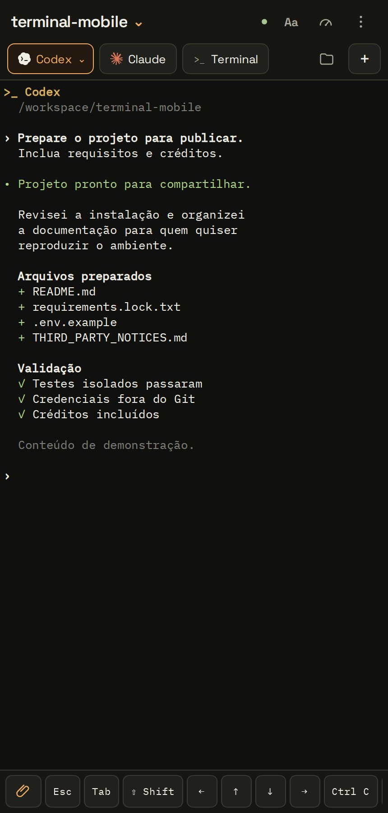
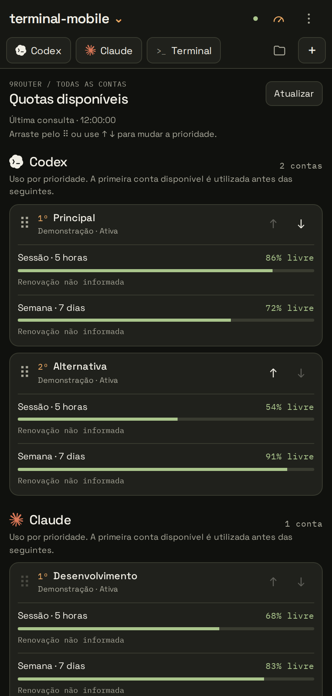
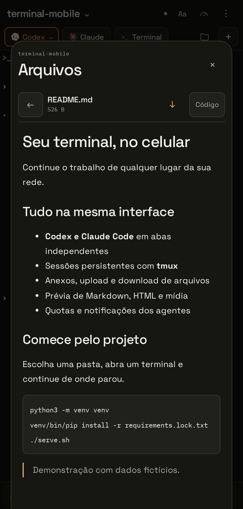

# Terminal Mobile

Painel web e PWA para usar **Codex, Claude Code e Bash pelo celular**, com sessões persistentes no tmux. Desenvolvido por **Daniel Carbonell (@flouds-dncarbonell)**, com assistência de Codex e Claude Code.

Abas por projeto, teclado auxiliar, histórico com gestos, anexos nas conversas, explorador de arquivos com upload/download e prévias de Markdown, HTML, imagens, áudio e vídeo. Inclui alertas, Web Push e painel de quotas/prioridades integrado ao 9router.

| Terminal no celular | Quotas e prioridades | Arquivos e prévias |
| :---: | :---: | :---: |
| [](docs/screenshots/terminal-mobile.png) | [](docs/screenshots/quotas-mobile.png) | [](docs/screenshots/files-mobile.png) |

*Capturas da interface real com conversas e contas fictícias. Toque nas imagens para ampliar.*

## Requisitos

- Linux ou Ubuntu no WSL2; Python 3.12+, Bash, tmux 3.2+, OpenSSL e `python3-venv`.
- Node.js 22 e npm; as CLIs `codex` e `claude` instaladas e autenticadas por você.
- [ttyd](https://github.com/tsl0922/ttyd) 1.7.7+ com suporte a `-W`, `-O` e `-a`. A versão dos repositórios antigos do Ubuntu pode ser insuficiente; use o release oficial adequado à arquitetura ou compile seguindo o upstream.
- [9router](https://github.com/decolua/9router), instalação global via npm. A instalação original usa **0.5.119**, Node 22.20.0 e Python 3.12. As integrações de quotas e auto-ping dependem de APIs internas e podem exigir ajustes em outras versões.
- Celular na mesma LAN ou rede privada (Tailscale é opcional); HTTPS confiável para PWA, clipboard e push.

`requirements.lock.txt` registra todas as dependências Python da instalação limpa validada; `requirements.txt` lista as dependências diretas.

Cada pessoa precisa configurar suas próprias contas e autorizações de uso. Nenhuma senha, sessão OAuth, chave, certificado privado, anexo ou conta da instalação original acompanha o projeto.

## Instalação

```bash
git clone https://github.com/flouds-dncarbonell/terminal-mobile.git
cd terminal-mobile
sudo apt update
sudo apt install python3-venv tmux openssl
python3 -m venv venv
venv/bin/pip install -r requirements.lock.txt
npm install -g 9router@0.5.119 @openai/codex
# Instale Claude Code conforme https://code.claude.com/docs/en/setup
# Instale ttyd >= 1.7.7 antes de continuar.
cp .env.example .env
```

Edite `.env`: escolha `TERMINAL_MOBILE_PROJECT` (uma pasta existente), o contato VAPID e, se necessário, o caminho do ttyd. O arquivo segue sintaxe de Bash e é carregado pelo `serve.sh`. Não coloque credenciais de provedores nele: use os fluxos de autenticação das ferramentas.

Execute `9router` uma vez, configure suas próprias contas pelo dashboard local e autentique as CLIs. O painel não altera automaticamente os arquivos de configuração do Codex/Claude: configure o uso do roteador conforme as instruções da versão instalada, escolhendo seus modelos. Sem essas etapas, quotas ou chamadas aos agentes podem falhar. O launcher procura `9router` no PATH e em instalações NVM; exige o executável `node` ao lado do launcher do 9router.

Descubra o IPv4 do computador acessível pelo celular e execute:

```bash
venv/bin/python setup.py 192.168.1.100
./serve.sh
```

Use seu próprio IP no lugar do exemplo. O setup pede login e senha sem exibir a senha, cria `credentials` com permissão 600 e gera uma CA e certificado exclusivos em `certs/`. Não substitui credenciais existentes. O ttyd instalado é referenciado por um link local ignorado pelo Git.

Abra `https://SEU_IP:7682/`. O HTTP em `http://SEU_IP:7681/` também existe para o fluxo inicial de instalação, mas Basic Auth não protege a senha em trânsito sem HTTPS. Prefira configurar o certificado pelo computador/rede confiável e usar HTTPS no celular. O certificado **público** da CA está em `/ca.crt`, após login. Instale-o e habilite confiança no aparelho; no iPhone, confira Ajustes → Geral → Sobre → Confiança de Certificados. Depois use Adicionar à Tela de Início. As chaves privadas permanecem no computador. Se o IP mudar, execute novamente `venv/bin/python update_network.py NOVO_IP` e reinicie o painel.

O servidor escuta em todas as interfaces nas portas 7681/7682; ttyd fica apenas em `127.0.0.1:17682` e 9router em `127.0.0.1:20128`. Para um proxy privado, use `./serve.sh --host 127.0.0.1`; `tailscale serve` pode fornecer HTTPS confiável. Não publique essas portas diretamente na internet.

**Este painel oferece acesso ao shell do usuário do serviço.** As novas abas Codex usam `--sandbox danger-full-access --ask-for-approval never` e as novas abas Claude usam `--dangerously-skip-permissions`. Os agentes podem alterar arquivos e acessar a rede sem confirmação. Use uma conta de sistema e projetos adequados a esse nível de acesso. O login é compartilhado, sem isolamento entre usuários.

## Uso

Escolha uma pasta no seletor de projetos e toque em `+` para abrir Codex, Claude ou shell. Toque no terminal para digitar; a barra inferior oferece teclas auxiliares. `Ctrl Z` suspende o agente e `fg` o retoma. O Codex usa `--no-alt-screen` para manter histórico rolável. O clipe adiciona até 8 arquivos/20 MB à conversa, sem enviar a mensagem automaticamente.

O explorador permite upload de até 100 MB por arquivo, download e prévias. Markdown usa DOMPurify; HTML executa scripts em iframe isolado. Projetos cadastrados delimitam as rotas de arquivos, mas o shell mantém as permissões do usuário do sistema. Anexos ficam em `attachments/` até remoção manual.

Quotas podem reordenar, desativar e reativar contas segundo disponibilidade; também há resgate automático de créditos de reset próximos da expiração. Para consultar sem essas automações use `./serve.sh --no-quota-automation`. O auto-ping nativo do 9router é independente dessa flag e pode consumir uso; configure-o no próprio 9router. Patches em `patches/` validam a estrutura antes de alterar builds compatíveis e criam backups locais. Atualizações do roteador exigem revisão de compatibilidade.

## Serviço e integração opcionais

Depois de testar manualmente, execute `./install-service.sh` para instalar um serviço **do seu usuário**, com o caminho atual do projeto e o PATH atual. Gerencie com `systemctl --user status|restart|stop terminal-mobile.service` (substitua pela ação desejada) e consulte `journalctl --user -u terminal-mobile.service`. Para iniciar sem login, habilite linger conforme a política da sua máquina. Reiniciar o gateway preserva os agentes no tmux; parar o gateway também não encerra as sessões tmux.

No WSL2, habilite systemd e reinicie o WSL antes de usar serviços. Para acesso do celular, configure rede espelhada ou encaminhamento de portas e firewall do Windows conforme sua rede. A automação PowerShell e as regras locais da máquina original não são distribuídas.

Opcionalmente, `source /CAMINHO/terminal-mobile/shell-integration.bash` no seu Bash encaminha chamadas desktop das CLIs para abas do painel. O socket padrão é `terminal-mobile`, separado da instalação original `terminal-mobile-test`.

## Push e hooks opcionais

Defina `TERMINAL_MOBILE_PUSH_CONTACT` como um URI de contato seu (`mailto:` ou HTTPS). No PWA instalado via HTTPS, toque no sino para autorizar e testar. A chave VAPID é gerada localmente; inscrições e estado são privados e ignorados pelo Git.

Para notificações de conclusão/perguntas, conecte `notify_hook.py` aos hooks suportados pela sua versão do Claude Code/Codex. O script lê JSON do evento em stdin; veja os eventos tratados no próprio arquivo. Use o caminho absoluto do `venv/bin/python` e do script. A configuração de hooks varia por versão e precisa ser instalada/aprovada por você: este projeto não copia configurações nem permissões de confiança da máquina original. Alertas inferidos de processos/tela continuam disponíveis, mas não detectam todas as conclusões ou perguntas. Serviços auxiliares de auto-ping não são instalados por padrão; `autoping_guard.py` é uma ferramenta avançada de manutenção do roteador.

## Validação

Testes isolados de autenticação, origem, confinamento, transferências, anexos, quotas e inicialização do roteador:

```bash
venv/bin/python -m unittest verify_project_files verify_attachments verify_quota verify_router_dependency
node verify_router_autoping.cjs
```

Os demais `verify_*` são testes de integração com navegador, tmux e/ou CLIs reais. Leia cada script antes de executá-lo; alguns criam abas e precisam de credenciais locais, serviço em execução, modelos autenticados ou porta de prévia específica. Para navegador, instale `requirements-dev.txt` e `venv/bin/playwright install chromium`; mídia pode exigir ffmpeg. Eles não fazem parte da suíte isolada acima.

## Segurança e reprodução

`.gitignore` exclui credenciais, `.env`, certificados, VAPID, JSON de estado, logs, anexos, backups e binários. Gere seus próprios dados com `setup.py`. Nunca adicione `~/.9router`, `~/.codex`, `~/.claude`, cookies ou tokens ao repositório. Em caso de vazamento, revogue as credenciais e substitua as chaves; apagar o arquivo num commit posterior não remove o histórico.

Arquivos de runtime ficam junto ao código e precisam de permissão de escrita do usuário do serviço. Faça backup privado dos projetos e, se necessário, das chaves locais. Não use esse backup como fonte para publicação.

## Créditos e licença

Autoria e direção: **Daniel Carbonell / [@flouds-dncarbonell](https://github.com/flouds-dncarbonell)**. Desenvolvimento assistido por **OpenAI Codex** e **Anthropic Claude Code**. Dependências, fontes e ferramentas têm créditos e licenças próprios em [THIRD_PARTY_NOTICES.md](THIRD_PARTY_NOTICES.md).

O código original deste repositório é distribuído sob [MIT](LICENSE). Isso permite reproduzir, adaptar e redistribuir preservando o aviso de copyright e a licença. Componentes de terceiros mantêm suas licenças.
